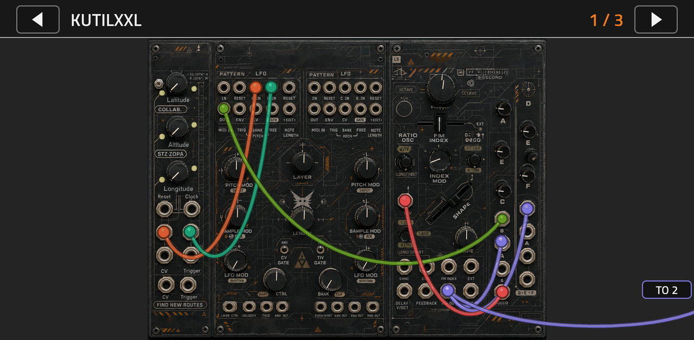
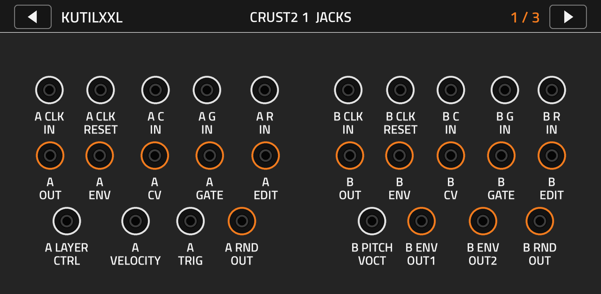

# KutilXXL

A groovebox of Bastl-style modules for the Akai Force / MPC OS (ARM, VST2), patched with virtual cables on the touch screen.

Version 0.2.1. Loads and runs on a Force (reported 2026-11-01); a full test of every module is still to come.

Three screens, `<` and `>` in the header switch between them. Touch a jack on any screen, then a jack on any screen: a cable
appears. Touch the same pair again to pull it out. Up to 4 cables per jack. Nothing is wired by default: it is silent until
you patch it. The ABC mixers feed the Force's audio outputs 1 and 2.

**Module jack windows (0.2.1).** Touch a module's empty art (not a knob, slider, button or jack) and its window opens: only
that module's jacks on a plain background, laid out as on the panel, big, each with its name (inputs white ring, outputs
orange). Touch a jack there, touch the empty area to close, open another module and touch the other jack: the cable appears
on the screen. Cables are only drawn on the three screens, never inside a window.

Modules: Kompas (clock and key tracker, receives the Force's keys and transport), Crust 2, Pizza, ABC, Wave Bard, Alchemist, Basil.

* `docs/MODULES.md`   what each jack and control does, and which parts are Bastl's own code
* `docs/INVENTORY.md` generated list of every parameter
* `TESTING.md`        what is tested offline and what has never run on a Force
* `CREDITS.md`        licences

Build: `./build.sh` (python3 + Pillow, gcc, `pip install ziglang`). Result: `build/package/L'Cronx - VST - KutilXXL/`.
Wave Bard looks for `SAMPLES.bin` (Wave Bard sample file format) in the plugin folder; without it a built-in synthesized
bank plays. Bastl's own sample file is not bundled (all rights reserved by Bastl).

Licence: GPL-3.0-or-later. See CREDITS.md.
